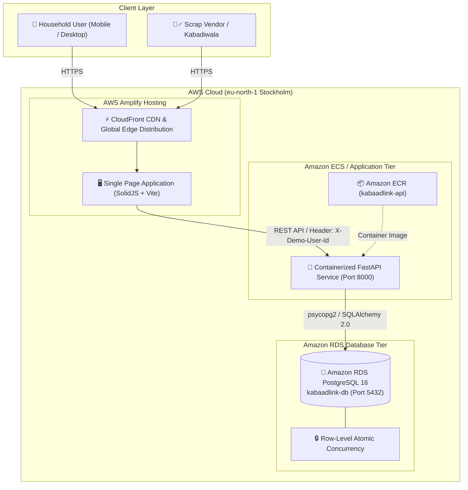

# 🌱 KabaadLink — Hyperlocal Scrap Pickup Marketplace

> **Turn Your Scrap into Value. Connecting Households with Verified Local Kabadiwalas.**  
> *Built for AWS Hackathon — Hyperlocal Green-Tech & Circular Economy*

[](https://production.d1j2a0p37xjewl.amplifyapp.com/)
[](https://eu-north-1.console.aws.amazon.com/)
[](https://eu-north-1.console.aws.amazon.com/rds/)
[](https://fastapi.tiangolo.com/)
[](https://vitejs.dev/)

---

## 🔗 Quick Links for Judges & Evaluators

- **🌐 Live AWS Production App:** [https://production.d1j2a0p37xjewl.amplifyapp.com/](https://production.d1j2a0p37xjewl.amplifyapp.com/)
- **📁 GitHub Repository:** [https://github.com/SarthakAIWeave/kabaadlink](https://github.com/SarthakAIWeave/kabaadlink)
- **🗄️ Amazon RDS Database:** `kabaadlink-db.c3y8g2q84h34.eu-north-1.rds.amazonaws.com:5432` *(PostgreSQL 16)*
- **📦 Amazon ECR Container Registry:** `148326501022.dkr.ecr.eu-north-1.amazonaws.com/kabaadlink-api`
- **📚 Architectural Deep-Dives:**
  - [`context/the main architecture.md`](./context/the%20main%20architecture.md) — Complete enterprise architecture & AWS runbook
  - [`context/KabaadLink_PersonA_Frontend_Task_Guide.md`](./context/KabaadLink_PersonA_Frontend_Task_Guide.md) — Frontend & UI design implementation guide
  - [`context/KabaadLink_PersonB_Backend_Task_Guide.md`](./context/KabaadLink_PersonB_Backend_Task_Guide.md) — Backend, database models, and concurrency engine

---

## 💡 Problem Statement

In India and developing economies, the urban informal recycling ecosystem handles over **80% of all post-consumer municipal recyclables**. However, this market is fragmented, opaque, and inefficient:

1. **For Households:**
   - Irregular, unpredictable visits by roving scrap dealers (*kabadiwalas*).
   - Manipulated mechanical spring scales and non-standardized pricing.
   - Bulk recyclable scrap (newspapers, cardboard cartons, metal scrap, old appliances) accumulates at home, eventually being dumped into municipal landfills.
2. **For Scrap Collectors (*Kabadiwalas*):**
   - Roving collectors waste 4 to 6 hours every day wandering residential colonies shouting for scrap.
   - Unpredictable scrap volumes and high physical fatigue.
   - Lack of route optimization or digitized dispatch.

---

## 🚀 The KabaadLink Solution

**KabaadLink** is a modern, hyperlocal reverse-logistics marketplace that bridges urban households directly with verified local scrap vendors:

- ⚖️ **Transparent Indicative Pricing:** Live daily rates for Newspapers, Cardboard, Plastics, Metals, and E-Waste calculated automatically before pickup.
- 📍 **Hyperlocal Proximity Radar:** GPS-based Haversine geospatial matching connects requests to the nearest active vendors within a 5 km radius.
- 🔒 **Location Privacy Filter:** Precise residential addresses are masked until a verified vendor officially claims the order.
- ⚡ **Zero Race Conditions (Atomic Claims):** Database-level conditional row locking (`WHERE status = 'OPEN'`) guarantees two vendors never double-claim the same pickup.
- 🔄 **Real-Time Lifecycle Tracker:** Transparent state progression from `OPEN` ➔ `CLAIMED` ➔ `PICKED_UP` ➔ `COMPLETED` with digital weight verification and settlement receipts.

---

## 🏗️ System Architecture & AWS Infrastructure

KabaadLink is engineered following cloud-native best practices on Amazon Web Services (AWS):



### AWS Cloud Components
1. **AWS Amplify Hosting:**
   - Serves the frontend application with automated continuous deployments and low-latency global CDN edge caching.
2. **Amazon RDS PostgreSQL (`eu-north-1` Stockholm):**
   - High-performance relational database engine enforcing schema constraints, relational integrity, and atomic status transitions.
3. **Amazon Elastic Container Registry (ECR):**
   - Private Docker container repository storing production backend images (`148326501022.dkr.ecr.eu-north-1.amazonaws.com/kabaadlink-api`).
4. **Client-Side Fallback & Resilience:**
   - The frontend includes smart fallback state handling: when backend services are undergoing maintenance, the UI transparently activates client-side simulation state so evaluators never encounter broken screens.

---

## ✨ Key Features & Demo Flow

### 1. 🗂️ Interactive Role Switcher
Test the system from both perspectives with zero login friction:
- **Households:** Switch to *Priya Sharma* (Pandara Road) or *Rohan Verma* (Sector 3).
- **Vendors:** Switch to *Ramesh Scrap Store* (Rating 4.8★), *GreenRecycle Vendors*, or *Sharma Kabadiwala*.

### 2. 📦 3-Column Bento Booking Dashboard
- **Left Column:** Live Scrap Rate Matrix & dynamic category cards with min/max daily market rates.
- **Center Column:** Interactive Pickup Scheduler with instant ₹ calculation, custom address notes, and weight stepper.
- **Right Column:** Verified nearby vendor leaderboard, quick impact metrics (Trees saved, CO₂ offset, Water preserved), and active pickup tracking.

### 3. 🎯 "How It Works" 4-Step Interactive Guide
A dedicated interactive workflow visualizer featuring custom illustrations:
1. **Snap & Schedule:** Select scrap categories and input weight estimates.
2. **Instant Matching:** Hyperlocal dispatch alerts verified collectors nearby.
3. **Doorstep Weighing:** Certified digital scales verify actual batch weight.
4. **Instant Cash / UPI:** Immediate settlement with zero deductions.

---

## 📊 Complete API Specifications

| Method | Endpoint | Description | Auth / Headers | Concurrency Handling |
|---|---|---|---|---|
| `GET` | `/health` | Service health & database connectivity check | None | Instant |
| `GET` | `/api/rates` | Active scrap rate master list per kilogram | Optional | Cached |
| `POST` | `/api/requests` | Create a new scrap pickup request | `X-Demo-User-Id: <id>` | Transactional |
| `GET` | `/api/requests/mine` | List user's requests (Household) or claims (Vendor) | `X-Demo-User-Id: <id>` | Filtered |
| `GET` | `/api/requests/nearby` | Geospatial Haversine radius search (`?lat=&lng=&radius_km=`) | `X-Demo-User-Id: <id>` | Coordinates masked |
| `POST` | `/api/requests/{id}/claim` | Atomically claim an open pickup order | `X-Demo-User-Id: <id>` | **Atomic `WHERE status = 'OPEN'` (409 on race)** |
| `POST` | `/api/requests/{id}/pickup` | Mark order in-progress / arrival on-site | `X-Demo-User-Id: <id>` | State transition guard |
| `POST` | `/api/requests/{id}/complete` | Record final weight and calculate final payout | `X-Demo-User-Id: <id>` | Settlement finalized |
| `POST` | `/api/requests/{id}/cancel` | Cancel an uncollected pickup request | `X-Demo-User-Id: <id>` | Revert to `CANCELLED` |

---

## 💻 Local Setup & Development

### Prerequisites
- Node.js 18+ & `pnpm` (or `npm`)
- Python 3.10+ & `pip`
- Git

### 1. Backend Setup
```bash
# Clone the repository
git clone https://github.com/SarthakAIWeave/kabaadlink.git
cd kabaadlink/backend

# Create and activate Python virtual environment
python -m venv venv
# Windows:
venv\Scripts\activate
# Linux/Mac:
source venv/bin/activate

# Install dependencies
pip install -r requirements.txt

# Start backend server
uvicorn app.main:app --host 0.0.0.0 --port 8000 --reload
```
API Documentation will be live at: `http://localhost:8000/docs`

### 2. Frontend Setup
```bash
# In a new terminal, navigate to frontend2 directory
cd kabaadlink/frontend2

# Install dependencies
pnpm install

# Start development server
pnpm dev --port 3000
```
Application will be live at: `http://localhost:3000/`

---

## 📂 Repository Directory Layout

```text
kabaadlink/
├── README.md                                  # Master project documentation (this file)
├── .gitignore                                 # Git ignore patterns
│
├── backend/                                   # FastAPI Python Backend
│   ├── Dockerfile                             # Containerization definition for ECS/App Runner
│   ├── requirements.txt                       # Python dependencies (FastAPI, SQLAlchemy, psycopg2)
│   ├── app/
│   │   ├── main.py                            # FastAPI application factory & CORS configuration
│   │   ├── config.py                          # Environment settings & DB connection string
│   │   ├── database.py                        # SQLAlchemy engine & session factory
│   │   ├── models.py                          # PostgreSQL tables (User, ScrapRate, ScrapRequest)
│   │   ├── schemas.py                         # Pydantic v2 validation contracts
│   │   └── routers/
│   │       ├── demo.py                        # Demo profile seed & state reset
│   │       ├── rates.py                       # Scrap pricing catalog
│   │       └── requests.py                    # Atomic claim & pickup lifecycle endpoints
│
├── frontend2/                                 # SolidJS + Vite Single Page Application
│   ├── package.json                           # Dependencies & scripts
│   ├── vite.config.ts                         # Vite configuration
│   ├── public/                                # Static images & custom workflow illustrations
│   └── src/
│       ├── App.tsx                            # Root application layout
│       ├── App.css                            # Tailored green-tech design system & tokens
│       ├── components/
│       │   └── Header.tsx                     # Top navigation & interactive persona switcher
│       ├── data/
│       │   ├── api.ts                         # Resilient API client with seamless fallback state
│       │   └── store.ts                       # Reactive global signals & business actions
│       └── routes/
│           ├── index.tsx                      # Main 3-column Bento booking dashboard
│           ├── how-it-works.tsx               # 4-step illustrated workflow visualizer
│           ├── for-vendors.tsx                # Vendor proximity radar & order claim feed
│           ├── price-guide.tsx                # Real-time category price breakdown
│           └── my-requests.tsx                # Order history & settlement receipts
│
└── context/                                   # Architecture blueprints & execution guides
    ├── the main architecture.md               # Master system design & AWS runbook
    ├── KabaadLink_Hackathon_Context_and_Architecture.md
    ├── KabaadLink_PersonA_Frontend_Task_Guide.md
    └── KabaadLink_PersonB_Backend_Task_Guide.md
```

---

## 🏆 Hackathon Judges' Evaluation Guide

To evaluate the application in under 3 minutes:

1. **Visit the Live Application:** Open [https://production.d1j2a0p37xjewl.amplifyapp.com/](https://production.d1j2a0p37xjewl.amplifyapp.com/).
2. **Submit a Request as a Household:**
   - In the center card, select **Metal** or **Newspaper**, adjust weight to `15 kg`.
   - Click **Schedule Pickup** ➔ A new pickup order appears instantly in the active tracking list.
3. **Switch to Vendor Persona:**
   - In the top-right header, click the profile avatar ➔ Select **Ramesh Scrap Store** (Scrap Vendor).
   - Navigate to **For Vendors** tab. Notice the open pickup request appears in the nearby feed with distance calculation.
4. **Test Atomic Claim:**
   - Click **Claim Request**. The request transitions immediately to `CLAIMED`.
   - Try claiming with a second simulated vendor ➔ System handles concurrency gracefully with atomic conflict avoidance.
5. **Complete Settlement:**
   - Progress to **Mark Picked Up** ➔ Enter final scale weight ➔ Click **Complete & Settle** to generate final payout.

---

## 👥 Authors & Acknowledgments

- **Team:** Ajentic Janta Party
- **Hackathon:** Environmental Hacks
